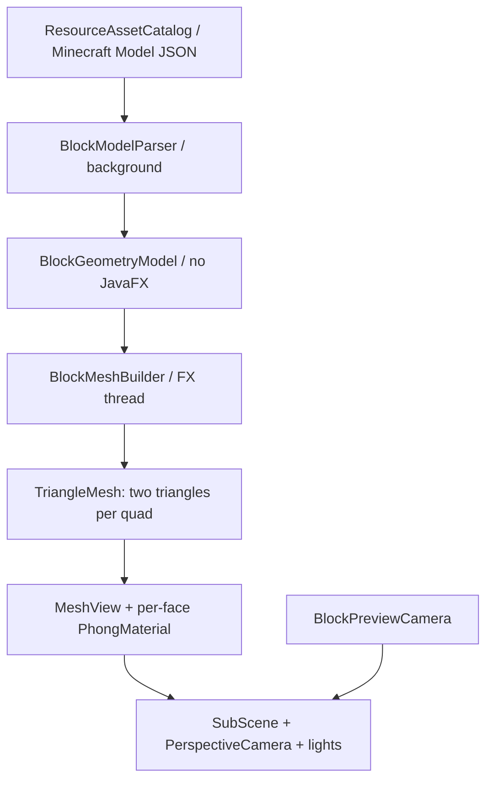
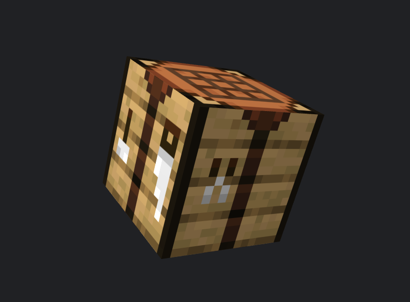
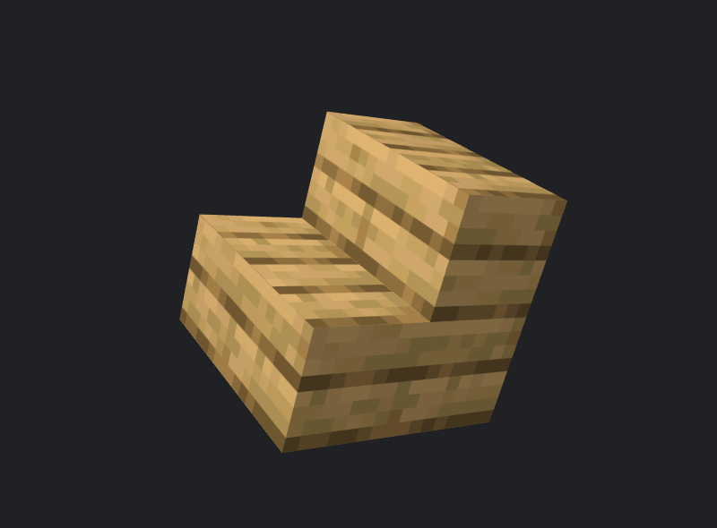

# Phase 18 — результат шагов 1–6

## Объём, версия и Git

Реализованы Git preparation, аудит прежнего рендеринга, geometry parser, Mesh Builder, per-face texture mapping и интерактивная 3D-сцена. Это завершение запрошенного первого этапа, а не всей Phase 18: каталог и Recipe Editor пока используют прежние превью. Шаги 7–10 автоматически не начинались.

- Основная папка: `L:\My Add\RecipeEditor`. Новое worktree или копия проекта не создавались.
- Ветка: `feat/phase-18-true-3d-block-rendering`.
- База: `master` / `origin/master`, `c6d3f1e`; Phase 17 уже объединена через PR #6.
- Исходный Git status был чистым. Fetch выполнен до разработки; reset/force/clean Git не использовались.
- Desktop version: `1.1.2-alpha.1`, по явному ответу пользователя на противоречие в задании.
- Единственный источник desktop version — `appVersion` в `gradle.properties`. Окно, About, build-info, логирование и Release Manifest продолжают получать версию через существующий build metadata pipeline; новых строк версии в контроллерах не добавлено.
- Companion `0.1.0`, Protocol `1`, Project Format `1` не изменены.
- Push не выполнялся: текущее задание требует коммитов и статуса push, но не даёт отдельной команды отправки ветки. Merge, Tag и GitHub Release не выполнялись.

## Почему прежний рендеринг был плоским

`ResourcePreview` создавал `ImageView` из результата `TextureResourceService`. `ModelTextureResolver` разрешал parent/texture references и выбирал плоский слой или образец текстуры. В этой цепочке не было геометрии, треугольников, камеры или SubScene. Runtime sprite metadata также не является baked mesh.

Подробный аудит: [PHASE18_RENDERING_AUDIT.md](PHASE18_RENDERING_AUDIT.md).

## Архитектура настоящего 3D



`BlockModelParser` использует существующие Jackson reader и asset catalog. Он сохраняет цепочку parent sources, наследует geometry и texture variables, применяет child overrides; дочерний `elements` заменяет родительский, а не добавляется к нему.

`BlockGeometryModel` хранит from/to, faces, texture source/ID, UV, face rotation, cullface, tint index, element rotation/origin/axis/rescale и shade. JavaFX в доменном пакете отсутствует. Модель и её коллекции неизменяемы, координаты и размеры ограничены.

`BlockMeshBuilder` создаёт четыре вершины и два треугольника на грань. Позиции вычисляются из фактических from/to. Element rotation применяется к конкретному элементу относительно его origin; rescale — по осям, перпендикулярным оси вращения. Преобразование координат: Minecraft `(x,y,z)` → JavaFX `(x-8,8-y,8-z)`.

Материалы назначаются отдельным MeshView. Несколько текстур не назначаются одному MeshView. UV нормализуются из 0..16, поддерживаются повороты 0/90/180/270. Default UV и углы element rotation сверены с локальными mapped sources Minecraft 1.20.1: `BlockElement` / `BlockFaceUV`.

`BlockPreview3DView` создаёт единственную интерактивную сцену выбранной модели. Есть PerspectiveCamera, AmbientLight и PointLight, центрирование, единый масштаб с сохранением пропорций, глубина и отсечение обратных граней. Размытие пиксельных текстур уменьшено предварительным nearest-neighbour увеличением diffuse map до ограниченного размера 256.

`BlockPreviewCamera` обрабатывает orbit, zoom 24..240 и reset. Пользовательское управление: ЛКМ + drag, колесо, double click, Reset View. Начальный ракурс показывает верх и боковые грани. Минимальная дистанция сохраняет геометрию перед near plane.

Парсинг и чтение PNG выполняются вне FX thread одним ограниченным worker. Создание TriangleMesh, MeshView и scene graph — на FX thread. Фоновый поток для каждой карточки не создаётся. На этом этапе сцена не подключена к карточкам вообще.

## Проверенные настоящие модели

Источник — настоящий локальный `minecraft-1.20.1-client.jar`, обнаруженный через импорт ISG. Геометрия не подменялась вручную созданным кубом.

| Model ID | Elements | MeshView / faces | Triangles | Distinct textures |
|---|---:|---:|---:|---:|
| `minecraft:block/stone` | 1 | 6 | 12 | 1 |
| `minecraft:block/crafting_table` | 1 | 6 | 12 | 4 |
| `minecraft:block/furnace` | 1 | 6 | 12 | 3 |
| `minecraft:block/oak_stairs` | 2 | 11 | 22 | 1 |
| `minecraft:block/oak_slab` | 1 | 6 | 12 | 1 |

Для `oak_slab` отдельно проверена высота 8 из 16; `oak_stairs` содержит два элемента и 11 реально заданных граней. Разные текстуры верстака и печи разрешаются из реальных JSON.





Это снимки JavaFX SubScene с MeshView, а не нарисованные изометрические изображения. Числа треугольников и изменения пикселей при вращении/zoom сохранены в [phase18/metrics.json](phase18/metrics.json). Все 15 снимков default/rotated/zoom находятся локально в `app/build/phase18-render-evidence/`; два примера сохранены рядом с отчётом и переживут `clean`.

## Результаты проверок

- `clean build`: **SUCCESS**, 4m 1s, 82 tasks. Архитектура: 12 модулей, циклов нет.
- Отдельный `test`: **SUCCESS**, 25s, up-to-date после чистой сборки.
- Unit: **343 tests, 341 passed, 2 skipped**, 0 failures/errors. Skip — существующие Windows symlink-проверки без нужных прав.
- Integration: **86 passed**, 0 failures/errors. Проверяются настоящие треугольники и размеры, slab/rotation, отдельные материалы/UV, реальный scene snapshot до/после orbit и zoom, границы zoom и reset.
- External: **1 passed**, 47s. `BlockRenderingEvidenceTest` последовательно открывает JavaFX Stage для пяти реальных моделей и проверяет/saves default, rotated, zoom images. Для каждой модели изменение перспективы подтверждено различающимися пикселями, а не только значениями угла.
- `git diff --check`: без ошибок.

Новые тесты: `BlockModelParserTest`, `BlockGeometryModelTest`, `BlockMeshBuilderTest`, `BlockTextureMappingTest`, `BlockPreview3DViewTest`, `BlockRenderingEvidenceTest`.

### Визуальная проверка Windows GUI — VERIFIED

Использован навык [computer-use](C:/Users/ziran/.codex/plugins/cache/openai-bundled/computer-use/26.1117.41037/skills/computer-use/SKILL.md).

Открыто окно `Minecraft Recipe Editor — interactive 3D model verification`. Для всех пяти моделей выполнены выбор, визуальный осмотр нескольких граней, вращение реальным drag и zoom колесом. У печи после вращения видна передняя грань; у лестницы — ступень и обратная сторона; у плиты — корректная толщина. Reset View проверен кнопкой на stone и double click на crafting table. Окно оставлено открытым на oak_stairs в исходном ракурсе для проверки пользователем.

Недостаток памяти и таймауты GUI helper/Gradle в начале сессии устранены после освобождения памяти пользователем. Финальные проверки выполнены на Java 21 с одним Gradle worker и heap 768m. В тестах исправлен жизненный цикл FX runtime: закрытие тестового Stage не завершает runtime последующих тестов.

## Запуск из основной папки

```powershell
Set-Location 'L:\My Add\RecipeEditor'
.\gradlew.bat :app:previewBlockModels '-PrealModpack=G:\PrismLauncher\instances\ISG-0.6.0-alpha.1-harsh'
```

Это проверочный launcher из test classpath, использующий production parser/builder/view. Обычный `:app:run` запускает основной редактор; его каталог пока не подключён к новой 3D-сцене по ограничению текущего этапа.

Команды воспроизведения проверок в этой среде:

```powershell
$env:JAVA_HOME = 'C:\Program Files\Eclipse Adoptium\jdk-21.0.10.7-hotspot'
.\gradlew.bat --no-daemon --max-workers=1 '-Dorg.gradle.jvmargs=-Xmx768m -Dfile.encoding=UTF-8' clean build
.\gradlew.bat --no-daemon --max-workers=1 '-Dorg.gradle.jvmargs=-Xmx768m -Dfile.encoding=UTF-8' test
.\gradlew.bat --no-daemon --max-workers=1 '-Dorg.gradle.jvmargs=-Xmx768m -Dfile.encoding=UTF-8' :app:externalTest --tests '*BlockRenderingEvidenceTest' '-PrealModpack=G:\PrismLauncher\instances\ISG-0.6.0-alpha.1-harsh'
```

Логи финальных и диагностических запусков: `build/phase18-verification/`. Активный интерактивный запуск пишет в `build/phase18-manual-ui.log`. XML/HTML тестов находятся в обычных module build directories. Эти временные файлы не добавлены в Git.

## Ограничения и последующие шаги

- Blockstate variants, multipart, X/Y transforms и uvlock относятся к Step 7 и пока не реализованы.
- Catalog snapshots, bounded thumbnail cache и shared Recipe Editor integration относятся к Steps 8-9. `BlockPreviewCacheTest` / `BlockstateResolverTest` сейчас не добавлены: соответствующие системы не реализованы на этом этапе.
- Custom model loaders, builtin/generated models без JSON elements и runtime custom renderers получают явную диагностику; runtime provider ещё не реализован. Поддержка GregTech/Create/Mekanism/Botania не заявляется.
- UV wrapping за пределами 0..16 пока не поддерживается и диагностируется.
- Biome tint не вычисляется: tint metadata сохранена, view предупреждает об untinted geometry. Освещение preview не воспроизводит Minecraft AO один в один.
- Cullface metadata сохранена; отсечение по соседним блокам не выполняется для изолированной модели.
- Анимации показывают первый проверенный кадр через существующий texture service.
- Лимиты: parent depth 32, 256 elements, rotation origin в пределах ±1024. Неизвестная geometry никогда не подменяется стандартным кубом.
- Отсутствующие model/parent/texture, циклы, неоднозначные источники, неверные UV/geometry и custom renderer не скрываются.

Вся Phase 18 не объявляется завершённой. Работа остановлена на запрошенных шагах 1–6 после демонстрации работающего настоящего 3D.

## Коммиты

```text
1352372 chore: bump version to 1.1.2-alpha.1
a17e12e docs(rendering): audit existing flat preview pipeline
77c8b80 feat(rendering): implement minecraft model geometry parsing
0a4a7fa feat(rendering): introduce real 3d block mesh renderer
56232cf feat(rendering): add interactive block preview camera
01c1ec7 feat(rendering): support per-face textures in interactive 3d view
7e1ee93 test(rendering): verify genuine vanilla meshes and model transforms
```

Финальный отчёт и evidence добавлены отдельным документационным коммитом; его SHA доступен через `git log -1`.

## Изменённые файлы

- `app/build.gradle.kts`
- `app/src/test/java/dev/recipeeditor/app/BlockRenderingEvidenceTest.java`
- `app/src/test/java/dev/recipeeditor/app/BlockRenderingPreview.java`
- `desktop-ui/src/main/java/dev/recipeeditor/ui/rendering/BlockMeshBuilder.java`
- `desktop-ui/src/main/java/dev/recipeeditor/ui/rendering/BlockPreview3DView.java`
- `desktop-ui/src/main/java/dev/recipeeditor/ui/rendering/BlockPreviewCamera.java`
- `desktop-ui/src/test/java/dev/recipeeditor/ui/BlockMeshBuilderTest.java`
- `desktop-ui/src/test/java/dev/recipeeditor/ui/BlockPreview3DViewTest.java`
- `desktop-ui/src/test/java/dev/recipeeditor/ui/BlockRenderFixtures.java`
- `desktop-ui/src/test/java/dev/recipeeditor/ui/BlockTextureMappingTest.java`
- `docs/reports/PHASE18_RENDERING_AUDIT.md`
- `docs/reports/PHASE18_REPORT.md`
- `docs/reports/README.md`
- `docs/reports/phase18/crafting_table-default.png`
- `docs/reports/phase18/metrics.json`
- `docs/reports/phase18/oak_stairs-default.png`
- `gradle.properties`
- `registry/src/main/java/dev/recipeeditor/registry/rendering/BlockGeometryModel.java`
- `registry/src/main/java/dev/recipeeditor/registry/rendering/BlockModelException.java`
- `registry/src/main/java/dev/recipeeditor/registry/rendering/BlockModelParser.java`
- `registry/src/test/java/dev/recipeeditor/registry/rendering/BlockGeometryModelTest.java`
- `registry/src/test/java/dev/recipeeditor/registry/rendering/BlockModelParserTest.java`
